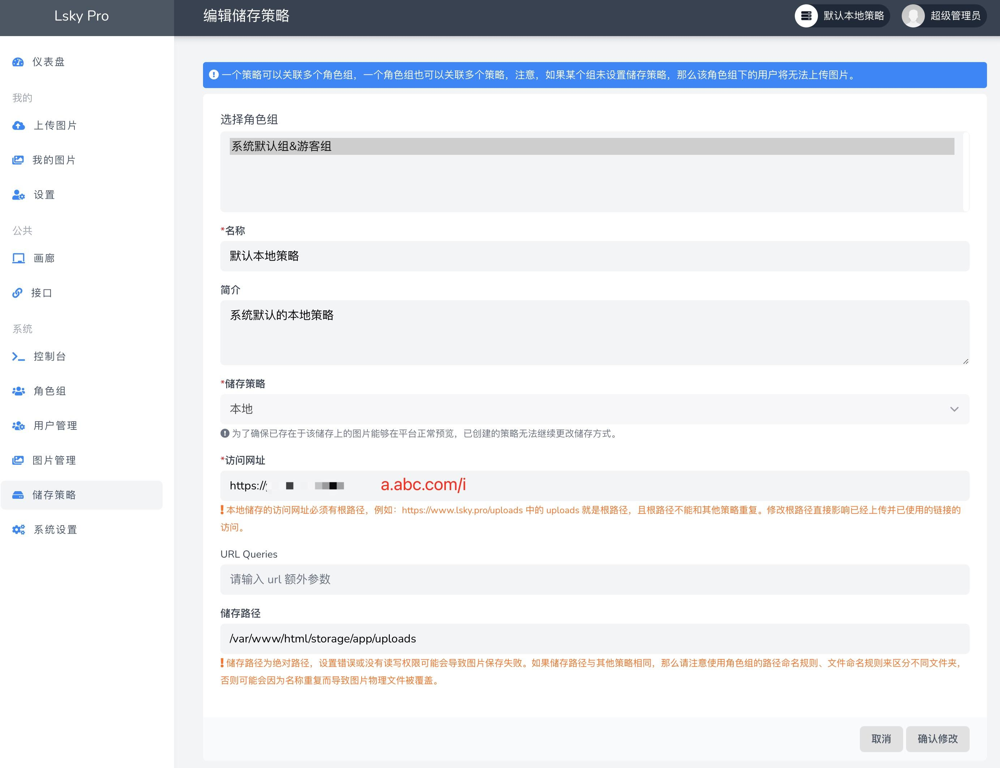

兰空图床使用已有一段时间，稳定性和速度非常不错，非常适合在nas上面搭建，省去服务器空间的不少费用。

### 1.docker-compose安装：

```
mkdir lsky-pro # 新建目录  
```

```
cd lsky-pro # 进入目录  
```

```
vim docker-compose.yml # 编辑文件  
```

```
version: '3'  
services:  
 lskypro:  
 image: halcyonazure/lsky-pro-docker:latest  
 restart: unless-stopped  
 hostname: lskypro  
 container_name: lskypro  
 environment:  
 - WEB_PORT=8089  
 volumes:  
 - $PWD/web:/var/www/html/  
 ports:  
 - "9080:8089"  
 networks:  
 - lsky-net  
  
 # 注：arm64的无法使用该镜像，请选择sqlite或自建数据库  
 mysql-lsky:  
 image: mysql:5.7.22  
 restart: unless-stopped  
 # 主机名，可作为"数据库连接地址"  
 hostname: mysql-lsky  
 # 容器名称  
 container_name: mysql-lsky  
 # 修改加密规则  
 command: --default-authentication-plugin=mysql_native_password  
 volumes:  
 - $PWD/mysql/data:/var/lib/mysql  
 - $PWD/mysql/conf:/etc/mysql  
 - $PWD/mysql/log:/var/log/mysql  
 environment:  
 MYSQL_ROOT_PASSWORD: lAsWjb6rzSzENUYg # 数据库root用户密码，自行修改  
 MYSQL_DATABASE: lsky-data # 可作为"数据库名称/路径"  
 networks:  
 - lsky-net  
  
networks:  
 lsky-net: {}  
```

```
sudo docker-compose up -d # 运行安装
```


### 2.域名链接：

不建议用反向代理带端口的方式链接，会造成图片加载不出来，需要另外修复。用Cloudflare Tunnel请直接跳到第3。
设置完，到后台-储存策略检查一下访问网址是否正确，例：

```
https://a.abc.com/i
```



#### 以前已做好代理带端口访问css错误的修复方法

Cloudflare Tunnel代理不会出现这种错误，按上面的方法设置后可以无视这条，直接跳到第3

编辑 .env 文件，追加一行：

```
ASSET_URL=https://你的域名
```

但是接口域名还是 http 的，所以在这个文件的 boot 方法里，

```
[lsky-pro/app/Providers/AppServiceProvider.php](https://github.com/lsky-org/lsky-pro/blob/6d0631b494c31788396cb948f691fe542e5bf8b4/app/Providers/AppServiceProvider.php#L31-L52)

Lines 31 to 52 in  [6d0631b](https://github.com/lsky-org/lsky-pro/commit/6d0631b494c31788396cb948f691fe542e5bf8b4)

public function boot()

{

// 是否需要生成 env 文件

if (! file_exists(base_path('.env'))) {

file_put_contents(base_path('.env'), file_get_contents(base_path('.env.example')));

// 生成 key

Artisan::call('key:generate');

}

// 如果已经安装程序，初始化一些配置

if (file_exists(base_path('installed.lock'))) {

// 覆盖默认配置

Config::set('app.name', Utils::config(ConfigKey::AppName));

Config::set('mail', array_merge(\config('mail'), Utils::config(ConfigKey::Mail)->toArray()));

View::composer('*', function (\Illuminate\View\View $view) {

/** @var Group $group */

$group = Auth::check() ? Auth::user()->group : Group::query()->where('is_guest', true)->first();

$view->with('_group', $group);

});

}

}
```

第 32 行下面追加一行：

```
\Illuminate\Support\Facades\URL::forceScheme('https');
```

### 3.对接PicGO

按如下方式填写：

- 将  `Lsky Pro Version`  选择为 V2
- Server： 填写你的图床地址即可，**不需要  `/api/v1/upload`**  ，**不要以  `/`  结尾**
- Auth Token：  `Bearer Your_token`
- 其他选填
-

#### 用Cloudflare Tunnel进行反向代理，免端口，亲参阅本站以下文章。

重磅功能：[Cloudflare Tunnel对内网Web服务进行反向代理发布Web站点](https://site.aaaz.top/archives/1719354739654)

**生成 Token：**

**your-email和your-password请先修改为自己的。**

```
sudo apt install curl # 安装 curl   
curl --location --request POST 'https://example.com/api/v1/tokens' \  
--form 'email="your-email"' \  
--form 'password="your-password"'
```

返回结果

```
"token":"2|xxxxxxxxxxxxxxxxxxxx"  #引号里面的就是api
```
