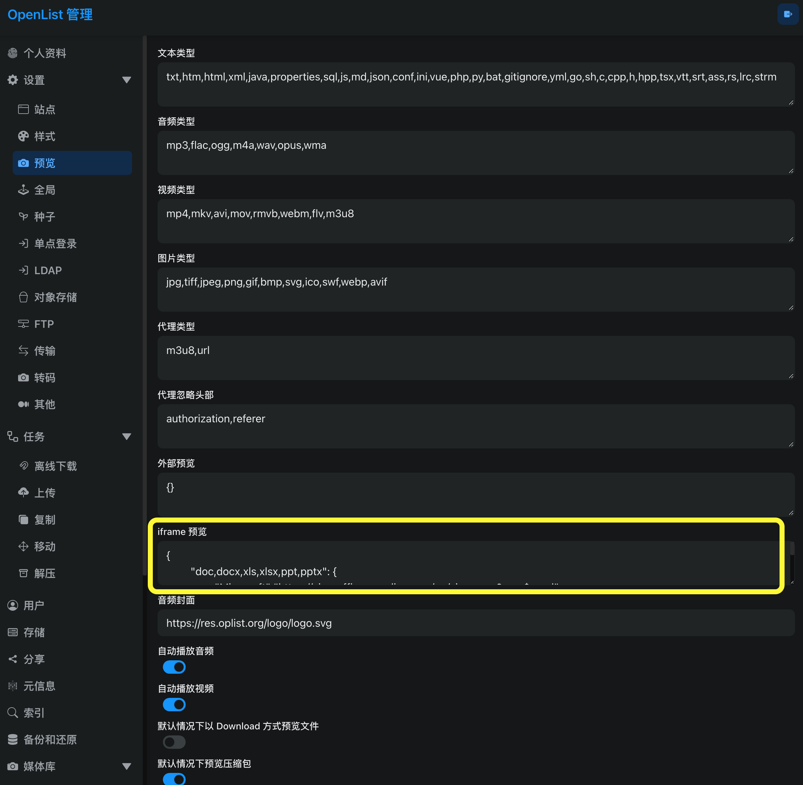

## openlist可以做什么？
openlist前身是alist，是一个网盘管理工具，可以接入百度网盘，阿里云盘，夸克网盘等离线下载，支持arai2,qbittorrent等工具。alist闭源，推荐大家安装openlist取代alist。

项目地址：https://github.com/OpenListTeam/OpenList
## 有那些应用场景？
目前的国内网盘基本上都限速严重，特别是百度云，不冲会员100kb左右下载速度，平时下载稍微大点的文件需要打开电脑等1个小时以上，安装了这工具就可以离线下载，不需要守着电脑旁边了，一般的网盘需要用它们的客户端，并不提供网页下载，所有单独安装arari2也没用。

## 一 安装方式
openlist支持几乎所有的平台，但一般主流安装在nas或openwrt（openwrt可以编译的时候打包进去或者在web ui单独安装）。建议使用docker安装在nas，管理方便。

首先进入安装目录
```
nano docker-compose.yml
```

```
services:
  openlist:
    image: openlistteam/openlist:latest
    container_name: openlist
    restart: unless-stopped
    ports:
      - "5244:5244"
    volumes:
      - ./data:/opt/openlist/data
      - /local/openlist/temp/qBittorrent:/opt/openlist/data/temp/qBittorrent
      - ./data/openlist_files:/openlist_files
      # - ./data/nasfiles:/nasfiles  # （按需修改为自己的路径）
      - /qbittorrent/download:/qbittorrent_download  # qbittorrent 下载路径按需加上
    environment:
      - UMASK=022
      - TZ=Asia/Shanghai
    user: "0:0"

```

安装后 http://localhost:5244 进入web ui管理添加本地网盘，和其他网盘，具体请参考官方wiki。

配套工具kkfileview，可以预览网页内的pdf文件，建议一起安装

```
services:
  kkfileview:
    image: wangbowen/kkfileview:5.1.0   # 或 latest
    container_name: kkfileview
    restart: unless-stopped
    ports:
      - "8012:8012"
    volumes:
      - ./file:/opt/kkFileView-5.0.0/file          # 缓存/上传文件目录（版本号可能随镜像变化，首次启动后可 docker exec 确认>
      # - ./config/application.properties:/opt/kkFileView-5.0.0/config/application.properties  # 如需自定义配置再挂载
    environment:
      - KK_FILE_DIR=/opt/kkFileView-5.0.0/file
      - TZ=Asia/Shanghai
      # 如果后面要做反向代理并使用 HTTPS，建议加上：
      # - KK_BASE_URL=https://你的域名/preview
      # - KK_CONTEXT_PATH=/preview
    mem_limit: 2g   # 建议至少 2G，Office 转换较吃内存
```

安装后 http://localhost:8012 进入web ui,不进也没关系，安装好就可以了。


### 1.3 安装arai2
```
  GNU nano 8.7.1                                        docker-compose.yml                                                  
services:
  aria2:
    image: p3terx/aria2-pro
    container_name: aria2
    restart: always
    environment:
      - RPC_SECRET=123456 #请替换成你的RPC密钥
      - RPC_PORT=6800
      - LISTEN_PORT=6888
      - PUID=0
      - PGID=0
      - TZ=Asia/Shanghai
    volumes:
      - ./config:/config
      - /local/download/aria2:/downloads  # arai2的实际下载路径
      - /local/openlist/data/temp/aria2:/opt/openlist/data/temp/aria2
    ports:
      - "6800:6800"
      - "6888:6888"
      - "6888:6888/udp"

  ariang:
    image: p3terx/ariang
    container_name: ariang
    restart: always
    ports:
      - "6880:6880"
```

安装后到openlist后台-其他-Arai2 输入 http://localhost:6800/jsonrpc  密钥用上面自己修改的
### 2. 整合到 OpenList（官方推荐方式）

OpenList 管理后台 → **设置 → 预览 → iframe 预览**，填入以下 JSON（把地址改成你的实际 kkFileView 地址）：



```
{
  "doc,docx,xls,xlsx,xlsm,ppt,pptx,csv,tsv,dotm,xlt,xltm,dot,dotx,xlam,xla,pages,wps,dps,et,ett,wpt,odt,ods,odp,pdf,ofd,rtf,epub,zip,rar,7z,tar,gz,vsd,vsdx,psd,tif,tiff,dwg,dxf,xmind,bpmn,eml,drawio,dcm,obj,3ds,stl,ply,gltf,glb": {
    "kkFileView": "http://你的服务器IP:8012/onlinePreview?url=$eb_url"
  }
}
```

- $eb_url 是 OpenList 内置变量：encodeURIComponent(base64($url))，正好对应 kkFileView 要求的参数格式。
- 如果 OpenList 和 kkFileView 都通过同一域名反向代理，建议统一使用 HTTPS，地址写成 https://你的域名/preview/onlinePreview?url=$eb_url（需配合下面反向代理配置）。

保存后，在 OpenList 文件列表中点击对应格式文件即可直接用 kkFileView 预览。

### 三、推荐反向代理配置（Nginx 示例，解决 HTTPS / 跨域）

如果 OpenList 使用 HTTPS，而 kkFileView 仍是 HTTP，浏览器会因混合内容拦截。建议给 kkFileView 也做反向代理：

nginx

```
location /preview/ {
    proxy_pass http://127.0.0.1:8012/;
    proxy_set_header Host $host;
    proxy_set_header X-Real-IP $remote_addr;
    proxy_set_header X-Forwarded-For $proxy_add_x_forwarded_for;
    proxy_set_header X-Forwarded-Proto $scheme;

    # 解决跨域（iframe 嵌入时可能需要）
    add_header Access-Control-Allow-Origin *;
    add_header Access-Control-Allow-Methods *;
    add_header Access-Control-Allow-Headers *;
}
```

然后在 kkFileView 的环境变量中设置：

YAML

```
environment:
  - KK_BASE_URL=https://你的域名/preview
  - KK_CONTEXT_PATH=/preview
```

（或直接修改挂载的 application.properties 中的 base.url 和 server.servlet.context-path）

重启 kkFileView 后，OpenList 的 iframe 预览地址改为 https://你的域名/preview/onlinePreview?url=$eb_url。

### 四、注意事项

- **内存**：Office / CAD 转换比较吃资源，建议容器至少 2G 内存，服务器整体内存更充足更好。
- **协议一致性**：OpenList 用 HTTPS 时，kkFileView 也必须 HTTPS，否则浏览器会拦截。
- **文件可访问性**：kkFileView 需要能直接下载到 OpenList 提供的文件 URL。若文件在内网存储或需要鉴权，可能需要额外配置代理或签名。
- **更多格式**：上面 JSON 已覆盖大部分常用格式，可按需增减扩展名。
